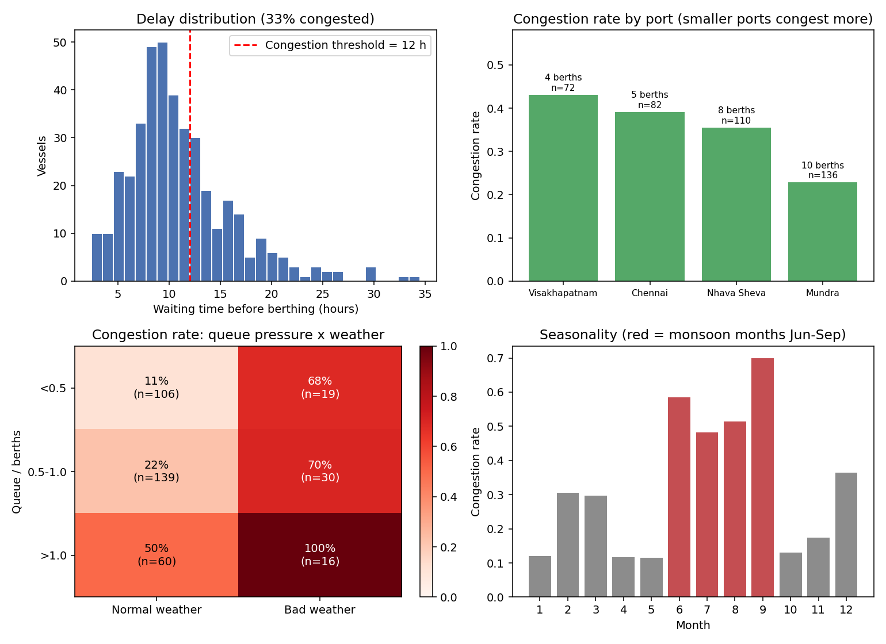

# Port Congestion Risk Prediction

Predicts the likelihood that a vessel will wait more than 12 hours before berthing, gives a confidence level, explains the key factors in plain English, and maps the risk to an operational action.

> **Note:** all results come from a **synthetic dataset** with known rules. They show how the methods behave on that simulation, not performance on real port or AIS data.

## Overview

| Step | What it does |
|---|---|
| **Define congestion** | Waiting time before berthing above 12 hours |
| **Data** | 400 simulated vessel arrivals, 4 ports, 12 months, with noise and missing values |
| **Models** | Regression approach (Logistic, Ridge) vs Random Forest (classifier, regressor) |
| **Test bed** | 7 tests over 5 seeds: head-to-head, data size, noise, split strategy, unseen port, calibration, tree depth |
| **Output** | Probability, Low/Medium/High confidence, SHAP-based explanation, recommended action |

Example output:

```
Medium risk (53%, low confidence): strong winds are expected (28 km/h), the port's recent
average delay is 12.8 h and arrival is on a weekend. Mitigating: it is outside monsoon
season, queue is 1 vessel against 4 berths and 3 vessels are due within 24h for 4 berths.
```

Decision bands: **above 70%** reroute or slow-steam, alert the consignee, rebook trucking; **40 to 70%** monitor and keep buffer time; **below 40%** proceed normally.

## Quick start

Tested on Python 3.13 (Windows). Run from the project folder.

### Option A: one command (recommended)

```bash
python run_demo.py
```

This installs any missing packages, generates the dataset and trains the models if they do not exist yet, then opens the demo at http://localhost:8501. Press `Ctrl+C` to stop.

```bash
python run_demo.py --all       # also reproduce every result (test bed, risk bands, SHAP, EDA), then open the demo
python run_demo.py --retrain   # rebuild the models
python run_demo.py --no-app    # run the setup/analysis steps without starting the demo
```

### Option B: step by step

| Step | Command | Needed for | What it does |
|---|---|---|---|
| 1 | `pip install -r requirements.txt` | Demo | Installs the packages |
| 2 | `python src/data_generation.py` | Demo | Creates `data/port_congestion_400.csv` |
| 3 | `python src/train.py` | Demo | Trains and saves the models in `models/` |
| 4 | `streamlit run app.py` | Demo | Opens the demo at http://localhost:8501 |
| 5 | `python src/experiments.py` | Results only | Runs the test bed (T1 to T7) into `results/` |
| 6 | `python src/decision.py` | Results only | Risk-band table |
| 7 | `python src/explain.py` | Results only | SHAP importance and example explanations |
| 8 | `python src/eda.py` | Results only | Exploratory figures |

**To run the demo, do steps 1 to 4. Steps 5 to 8 are only needed to reproduce the results and figures.**

- If `streamlit` is not recognised on Windows, use `python -m streamlit run app.py`.
- If Streamlit asks for an email on first run, press Enter.
- `models/` is not committed, so it must be built (step 3, or Option A) after cloning.
- Seeds are fixed, so reruns reproduce the same numbers.

## Repository structure

```
port-congestion/
├── run_demo.py            # one-command launcher
├── app.py                 # Streamlit demo
├── requirements.txt
├── data/                  # synthetic dataset (generated)
├── src/
│   ├── data_generation.py # simulation, ground truth, noise
│   ├── train.py           # features, pipelines, time-based split
│   ├── evaluate.py        # metrics, confidence labels, plots
│   ├── experiments.py     # test bed (T1 to T7)
│   ├── explain.py         # SHAP + plain-English explanations
│   ├── decision.py        # risk band -> action
│   └── eda.py             # exploratory plots
├── results/               # CSV tables and figures
├── models/                # saved models (not in git)
└── report/                # technical report (PDF)
```

## Headline results

Time-based split (train on earlier arrivals, test on later), mean over 5 seeds, synthetic data.

| Model | Test AUC | Delay MAE (h) |
|---|---|---|
| Logistic / Ridge Regression | 0.865 | 2.22 |
| Random Forest | 0.864 | 2.07 |
| Single Decision Tree | 0.755 | n/a |

The two approaches are statistically tied for classification, and a single tree is clearly worse. The report covers the other six tests, calibration, explainability and the decision bands in detail.



## Key limitations

- The models learn my simulation rules, so scores do not prove real-world performance.
- With 400 rows, most gaps between models fall within one standard deviation.
- Calibration did not improve Brier scores in this setup.
- Explanations show what the model relies on, not causal effects.

See the report for assumptions and what would change with real AIS data.

## Troubleshooting

| Problem | Fix |
|---|---|
| App says "Trained models not found" | Run `python src/train.py`, then reload |
| `ModuleNotFoundError` | Run `python run_demo.py` (it installs missing packages) or `pip install -r requirements.txt` |
| `streamlit` not recognised | Use `python -m streamlit run app.py` |