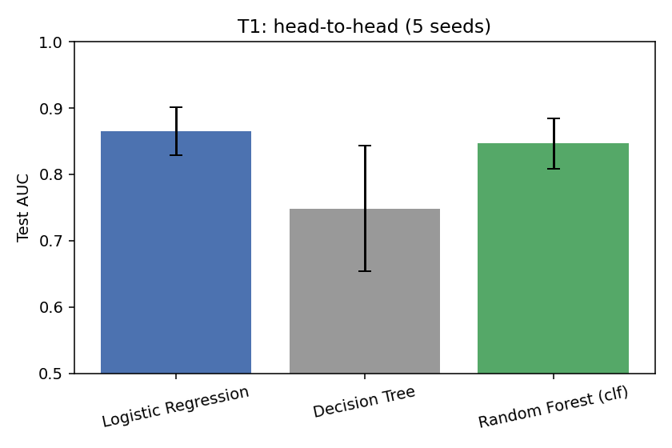
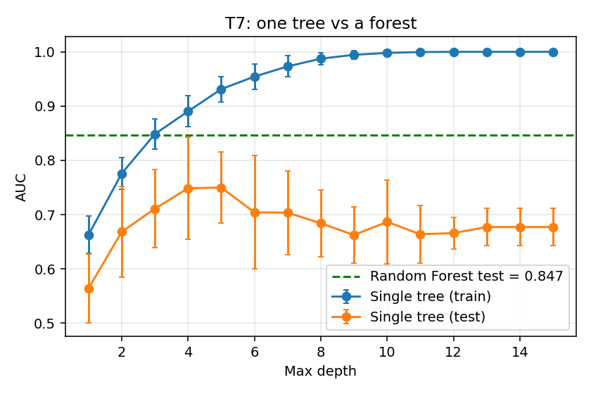
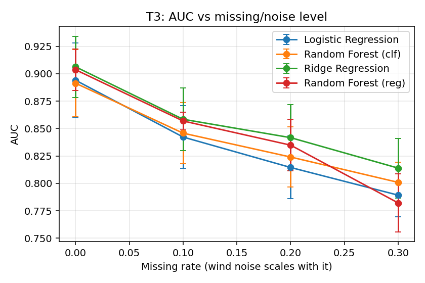
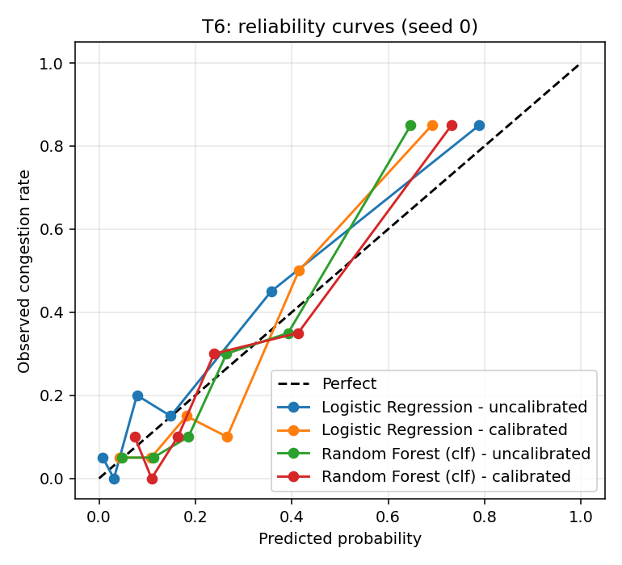
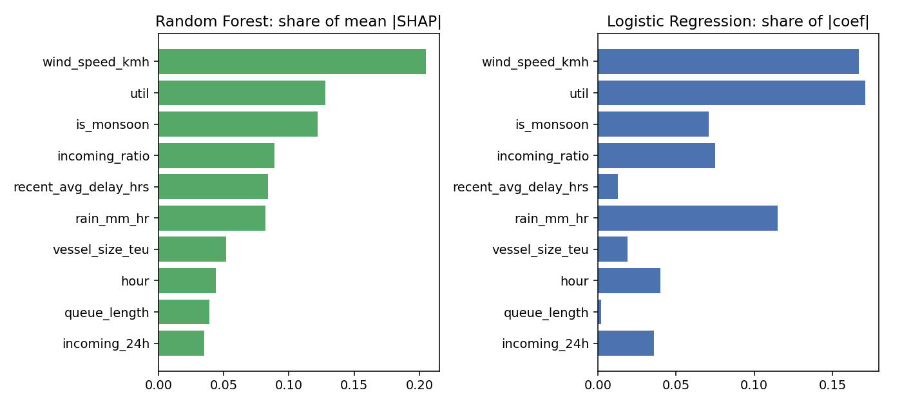

# Port Congestion Risk Prediction

Predicts the likelihood that a vessel arriving at a port will wait more than 12 hours before berthing, gives a confidence level, explains the key factors in plain English, and maps the risk to an operational action.

Built for the Aiqon AI Internship take-home assignment, *Predicting Port Congestion and Shipment Delays Using AI*.

> **Important:** all results come from a **synthetic dataset** that I generated with known rules. They show how the methods behave on that simulation. They are not validated on real port or AIS data. See [Limitations](#limitations).

---

## 1. What the system does

For a given shipment and port, the system produces:

| Output | How |
|---|---|
| **Likelihood of congestion** | Probability from a Random Forest classifier (compared against Logistic Regression) |
| **Confidence score** | Low / Medium / High, based on how far the probability is from 0.5 |
| **Key contributing factors** | SHAP values turned into a plain-English sentence |
| **Operational decision** | Risk bands: above 70% act, 40 to 70% monitor, below 40% proceed |
| **Delay estimate (hours)** | Ridge and Random Forest regressors (secondary track) |

Example output (from `results/example_explanations.txt`):

```
Medium risk (53%, low confidence): strong winds are expected (28 km/h), the port's recent
average delay is 12.8 h and arrival is on a weekend. Mitigating: it is outside monsoon
season, queue is 1 vessel against 4 berths and 3 vessels are due within 24h for 4 berths.
Actions: Confidence is low: verify live queue and weather data before acting; Monitor queue
and weather updates every few hours; Keep buffer time in the downstream schedule; ...
```

---

## 2. Approach in one page

1. **Define congestion.** Waiting time before berthing greater than **12 hours** is congested (`congested = 1`). The raw delay in hours (`delay_hours`) is kept as well.
2. **Simulate a realistic dataset** (400 vessel arrivals, 4 ports, 12 months) using a documented formula plus noise, with deliberate missing values and noisy sensor readings.
3. **Compare two approaches** on identical data and splits, as a classifier and as a delay regressor:

   | | Regression approach | Random Forest approach |
   |---|---|---|
   | Probability of congestion | Logistic Regression | Random Forest Classifier |
   | Delay in hours | Ridge Regression | Random Forest Regressor |

   A single Decision Tree is used only in the depth-sweep test, to show why a forest of trees beats one tree.
4. **Run a test bed** of 7 tests (head-to-head, data size, noise, split strategy, unseen port, calibration, tree depth). Each test uses 5 dataset seeds and reports mean ± std.
5. **Explain predictions** with SHAP and compare against Logistic Regression coefficients.
6. **Connect to decisions** with risk bands and recommended actions, shown in a Streamlit demo.

---

## 3. Quick start

Tested with Python 3.13 on Windows. Run all commands from the project root.

```bash
# 1. Install dependencies
pip install -r requirements.txt

# 2. Generate the 400-row synthetic dataset  ->  data/port_congestion_400.csv
python src/data_generation.py

# 3. Train and save the models  ->  models/*.joblib, results/final_metrics.csv
python src/train.py

# 4. Run the full test bed  ->  results/*.csv, results/figures/*.png
python src/experiments.py

# 5. Risk bands, explanations and EDA
python src/decision.py
python src/explain.py
python src/eda.py

# 6. Launch the demo at http://localhost:8501
streamlit run app.py
```

Notes:
- If the `streamlit` command is not recognised on Windows, use `python -m streamlit run app.py`.
- Steps 4 and 5 are not needed for the demo. For the demo you only need steps 1 to 3.
- `models/` is not committed to git. Run `python src/train.py` after cloning, before starting the app.
- All random seeds are fixed, so reruns reproduce the same numbers.

---

## 4. Repository structure

```
port-congestion/
├── README.md
├── requirements.txt
├── .gitignore
├── app.py                       # Streamlit demo
│
├── data/
│   └── port_congestion_400.csv  # synthetic dataset (generated)
│
├── src/
│   ├── data_generation.py       # simulation: features, delay formula, label, noise, missing values
│   ├── train.py                 # features, sklearn pipelines, time-based split, final training
│   ├── evaluate.py              # metrics, confidence labels, calibration and confusion plots
│   ├── experiments.py           # test bed T1 to T7
│   ├── explain.py               # SHAP + plain-English explanations, global importance
│   ├── decision.py              # risk band -> recommended actions
│   └── eda.py                   # exploratory plots and summary
│
├── results/                     # tables and figures produced by the scripts
│   ├── *.csv, *.txt
│   └── figures/*.png
│
├── models/                      # saved models (not in git, rebuild with train.py)
└── report/                      # technical report (PDF)
```

---

## 5. Data and ground truth

The dataset is generated by `src/data_generation.py` (400 rows, seed 42, arrivals between 2025-01-03 and 2025-12-29, sorted by time).

### Ports

| Port | Berths | Base delay (h) | Share of arrivals |
|---|---|---|---|
| Mundra | 10 | 1.0 | 32% |
| Nhava Sheva | 8 | 2.0 | 30% |
| Chennai | 5 | 2.5 | 20% |
| Visakhapatnam | 4 | 3.0 | 18% |

### Columns

| Column | Description |
|---|---|
| `arrival_time`, `hour`, `day_of_week`, `month` | Arrival timing |
| `port`, `berth_capacity` | Port and its number of berths |
| `queue_length` | Vessels already waiting |
| `incoming_24h` | Vessels due within the next 24 hours |
| `wind_speed_kmh`, `rain_mm_hr` | Weather |
| `vessel_size_teu` | Vessel size |
| `recent_avg_delay_hrs` | Mean delay of the previous 5 vessels at the same port |
| `delay_hours` | Simulated waiting time (regression target) |
| `congested` | `1` if `delay_hours > 12` (classification target) |

### How delay is simulated (ground truth)

```
delay = port_base_delay
      + 2.2 * (queue / berths) + 9.0 * max(queue/berths - 1, 0)^1.5   # queue pressure, jumps above capacity
      + 2.5 * (incoming_24h / berths)                                  # arrival density
      + 2.5 * bad_weather + 0.04 * wind + 0.25 * rain                  # weather
      + 4.0 * (queue / berths) * bad_weather                           # weather x traffic interaction
      + 1.5 * night + 1.2 * weekend + 1.5 * monsoon                    # time effects
      + vessel_size_teu / 5000                                         # larger vessels take longer
      + Normal(0, 2)                                                   # noise

bad_weather = wind > 30 km/h or rain > 6 mm/h      night = 20:00 to 06:00      monsoon = Jun to Sep
congested   = delay > 12 hours
```

Resulting class balance is **33.2% congested** (23% at Mundra up to 43% at Visakhapatnam).

### Real-world messiness added on purpose

- Wind readings carry sensor noise (SD 4 km/h).
- About 5% of `queue_length`, `wind_speed_kmh` and `rain_mm_hr` values are missing. The first vessel at each port has no history, so `recent_avg_delay_hrs` is missing there too.
- `recent_avg_delay_hrs` uses **only earlier vessels** at the same port, so there is no leakage of the current vessel's delay.


---

## 6. Modelling details

- **Split:** time-based, 70/30. Train on the first 280 arrivals (to 2025-09-11), test on the last 120 (from 2025-09-12). Congestion rate is 36% in train and 27% in test.
- **Features:** the raw columns above plus `util` (queue / berths), `incoming_ratio` (incoming / berths), `is_night`, `is_weekend`, `is_monsoon`.
- **`month` is deliberately not a model feature.** In a time-based split the test months are unseen, and SHAP showed the Random Forest using `month` as a time proxy (24% of its importance). `is_monsoon` carries the seasonal signal instead.
- **Preprocessing (in sklearn Pipelines, fit on training data only):** median imputation for missing values, standard scaling for linear models only, one-hot encoding for `port`.
- **Hyperparameters (fixed, never tuned on the test set):** Random Forest 200 trees with `min_samples_leaf=3`; Logistic Regression defaults; Ridge `alpha=1`; Decision Tree `max_depth=4` in the head-to-head.
- **Confidence:** the distance of the probability from 0.5. Below 0.15 is Low, below 0.30 is Medium, otherwise High.
- **Calibration:** `CalibratedClassifierCV` with sigmoid scaling and time-ordered folds, evaluated in test T6.

---

## 7. Results

All numbers are on the **synthetic** test period. Test-bed results are mean ± std over 5 dataset seeds, where the data is regenerated for each seed. Full tables are in `results/`.

### T1: Head-to-head (time-based split)

| Model | AUC | Precision | Recall | F1 | Brier |
|---|---|---|---|---|---|
| Logistic Regression | 0.865 ± 0.034 | 0.673 | 0.591 | 0.617 | 0.127 |
| Random Forest (classifier) | 0.864 ± 0.034 | 0.753 | 0.543 | 0.612 | 0.133 |
| Decision Tree (depth 4) | 0.755 ± 0.094 | 0.592 | 0.542 | 0.559 | 0.168 |

| Model (delay in hours) | MAE (h) | RMSE (h) | R² | AUC if used as a congestion score |
|---|---|---|---|---|
| Ridge Regression | 2.217 ± 0.261 | 2.865 | 0.484 | 0.881 |
| Random Forest (regressor) | 2.066 ± 0.305 | 2.728 | 0.544 | 0.889 |

**Takeaway:** the two approaches are statistically tied for classification. The Random Forest has a slightly lower delay error, but the gaps are within one standard deviation, so I do not claim a winner.

### T2 to T7: what each test shows

| Test | Question | Finding |
|---|---|---|
| **T2** Data size (100 to 400 rows) | Does RF need more data? | At 100 rows Logistic AUC is 0.84 vs RF 0.79 (high variance, ±0.12). From 200 rows they are level. |
| **T3** Missing/noisy data (0 to 30%) | Which is more robust? | All models degrade. At 30%, Ridge is best (AUC 0.814) and the RF regressor drops most (0.904 to 0.782). |
| **T4** Random vs time split | Does a random split flatter results? | Yes. Logistic F1 is 0.757 on a random split vs 0.617 on a time split. Part of this gap is the lower congestion rate in the test period. |
| **T5** Leave-one-port-out | Does it generalise to an unseen port? | Mostly yes: AUC 0.88 to 0.89 overall. Chennai is hardest, with the highest variance (±0.08). |
| **T6** Calibration | Does calibration help? | Not on this data. Brier scores are about equal or slightly worse after calibration (RF 0.133 to 0.139), likely because only about 280 training rows are split across 3 time folds. |
| **T7** Tree depth | One tree vs a forest? | A single tree reaches train AUC 1.0 but its test AUC peaks at 0.755 (depth 4). The forest scores 0.864. |

| | |
|---|---|
|  |  |
|  |  |

### Operational decision bands (120 test shipments)

| Band | Rule | Shipments | Actually congested |
|---|---|---|---|
| HIGH | probability above 70% | 10 (8%) | 70% |
| MEDIUM | 40 to 70% | 25 (21%) | 60% |
| LOW | below 40% | 85 (71%) | 12% |

Recommended actions per band:

- **HIGH:** reroute or slow-steam the vessel, alert the consignee and customs broker, rebook trucking or rail slots.
- **MEDIUM:** monitor queue and weather, keep buffer time, pre-clear documents.
- **LOW:** proceed normally.
- If confidence is Low in a HIGH or MEDIUM case, the system first advises verifying live queue and weather data.

The HIGH and MEDIUM bands contain few shipments, so the gap between them should not be over-read.

### Explainability

Mean |SHAP| for the Random Forest compared with Logistic Regression coefficients (`results/global_importance.csv`):

| Feature | RF share | Logistic share |
|---|---|---|
| Wind speed | 20.5% | 16.7% |
| Queue / berths | 12.8% | 17.1% |
| Monsoon season | 12.2% | 7.1% |
| Incoming / berths | 8.9% | 7.5% |
| Recent port delay | 8.4% | 1.3% |
| Rain | 8.2% | 11.5% |

Both models rank wind and queue pressure at the top, but only 2 of their top 5 features overlap. The models split credit differently among correlated features (queue length, queue ratio, berth capacity), so individual importances should be read with care.



---

## 8. Demo app

```bash
streamlit run app.py
```

Choose a scenario preset or set the shipment details in the sidebar (port, month, day, hour, queue, incoming vessels, wind, rain, vessel size, recent port delay). The page updates live and shows the risk band and probability, the confidence level, the plain-English reason, a SHAP chart of factors raising or lowering the risk, and the recommended actions. Tick "recent average delay is unknown" to see how a missing value is handled.

Suggested walkthrough: start on **Calm day** (low risk), raise wind above 30 km/h, then add queue until the risk crosses 40% and 70%.

---

## 9. Assumptions

- Congestion is defined as waiting time before berthing of more than 12 hours. The threshold is a design choice; the pipeline works with any threshold by regenerating the label.
- Delay depends on the factors listed in section 5. Real ports have more drivers (labour, customs, equipment failures, schedule bunching).
- Night is 20:00 to 06:00. Monsoon is June to September. Bad weather is wind above 30 km/h or rain above 6 mm/h.
- Each row is treated as an independent vessel arrival. In reality vessels in the same queue influence each other's waiting time.
- Hyperparameters are fixed defaults. With 400 rows, extensive tuning would mostly overfit.

---

## 10. Limitations

- **Synthetic data.** The models learn my simulation rules, so good scores show the method works on a known structure, not that it would work at a real port. The engineered ratios (`util`, `incoming_ratio`) hand Logistic Regression most of the structure, which is a reason it matches the Random Forest here.
- **Small data.** With 400 rows (120 in the test set), most differences between models fall inside one standard deviation. Band-level results such as the 10 HIGH shipments are especially fragile.
- **Distribution shift across the split.** Congestion is 36% in train and 27% in test because the monsoon months fall in the training period. This affects the random-vs-time comparison.
- **Calibration** did not improve Brier scores in this setup.
- **Explanations show what the model relies on, not causal effects.** Single-row SHAP values can be noisy, so the explanation text skips phrases that contradict known risk directions (for example night arrival listed as a mitigating factor).
- **No live data.** The demo takes manually entered values, and there is no real-time queue or weather feed.

### What would change with real AIS data

- Derive queue length, arrivals and waiting time from vessel positions and port-call timestamps (anchorage dwell time before berthing).
- Use real weather and tide data and actual berth schedules.
- Add features such as terminal productivity, vessel type and cargo, and the schedule reliability of the carrier.
- Validate with a rolling-origin time split over multiple years, and re-check calibration with far more data.
- Check seasonality and port-specific behaviour against real history instead of assuming them.

---

## 11. Troubleshooting

| Problem | Fix |
|---|---|
| `streamlit` is not recognised | Run `python -m streamlit run app.py` |
| App says "Trained models not found" | Run `python src/train.py`, then reload the page |
| `ModuleNotFoundError` | Run `pip install -r requirements.txt` |
| `FileNotFoundError` for the CSV | Run `python src/data_generation.py` (`train.py` also regenerates it automatically) |
| Scikit-learn warnings in the console | Safe to ignore |

---

## 12. Tech stack

Python, NumPy, pandas, scikit-learn, SHAP, matplotlib, joblib, Streamlit.
